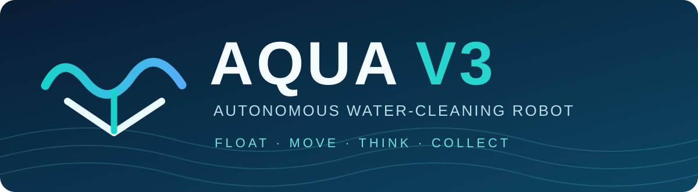
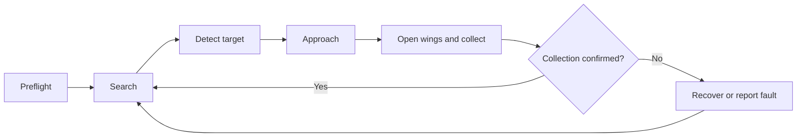
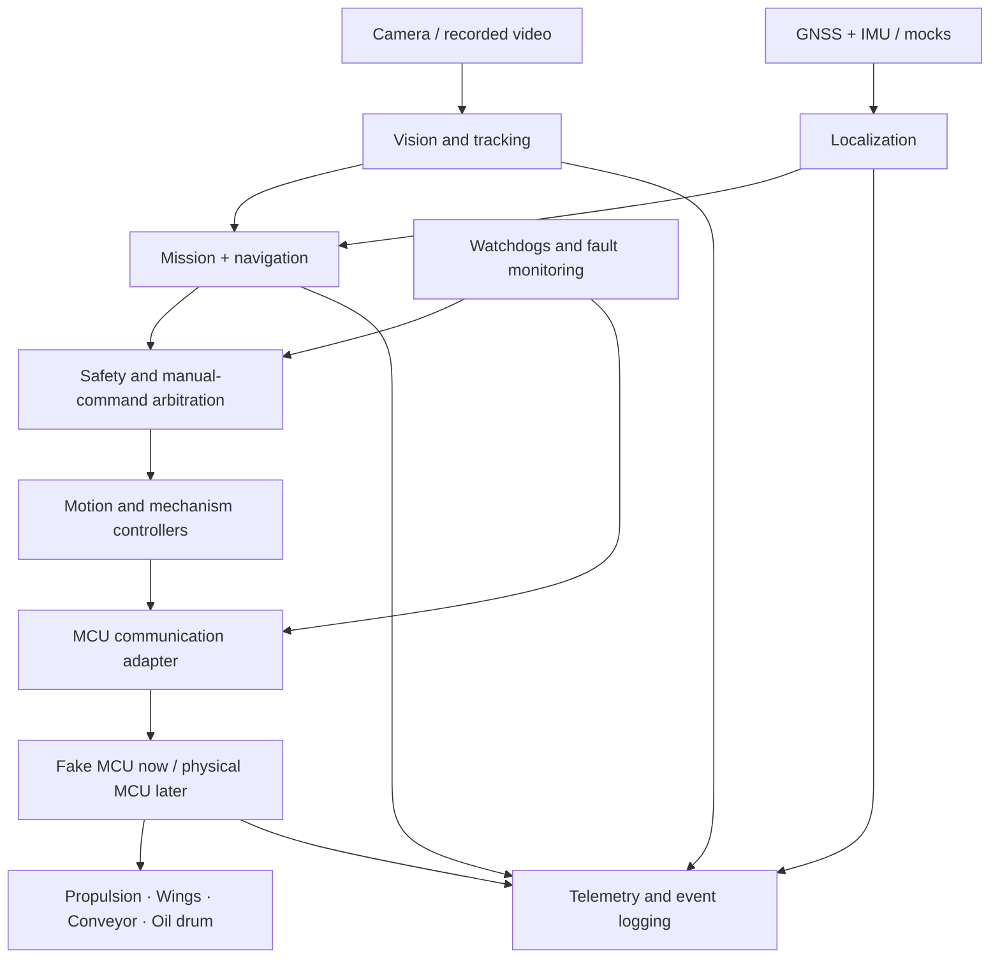

<div align="center">



# AQUA V3
### An autonomous surface robot for cleaner waterways

**FLOAT · MOVE · THINK · COLLECT**

[](#about-the-project)
[](#current-project-status)
[-147c96?style=flat-square)](#development-environment)
[](#current-project-status)

**[Project Buildboard](https://aqua-v3-buildboard.admirableactor.chatgpt.site)** · [Architecture](#software-architecture) · [Roadmap](#development-roadmap) · [Safety](#safety-first) · [Team](#team-responsibilities)

</div>

---

## 🌊 About the project

**AQUA V3** is a proposed autonomous surface-water cleaning robot designed to detect floating litter, approach it safely, guide it into a central intake, and transport it to a removable waste bin. The robot combines **computer vision, navigation, differential propulsion, mechanical collection and safety monitoring** in one system.

The mechanical concept uses **two hulls**, **front-opening collection wings** that create a funnel, and a **central conveyor**. A separate, experimental **oleophilic rotating-drum oil-recovery module** is under investigation; its effectiveness has **not** been established.

> **Engineering principle:** A concept drawing is not a physical test. Every major decision needs measurable evidence.

### The AQUA puzzle

| 🌊 Float | 🚤 Move | 👁️ Think | ♻️ Collect | ⚡ Power | 🛢️ Experiment |
|---|---|---|---|---|---|
| Twin-hull platform | Independent left/right propulsion | Camera, GNSS, IMU, autonomy | Wings, conveyor, removable bin | Battery and proposed solar input | Oil-attracting drum, scraper and reservoir |

### One complete collection mission



All active modes are subject to safety overrides. Return-to-home is only permitted when localization, propulsion and remaining energy are adequate.

## 📍 Current project status

| Area | Status | Evidence still needed |
|---|---|---|
| AQUA V3 concept and engineering presentation | **Documented concept** | Validate dimensions and manufacturing assumptions |
| 3D-printed demonstration model | **Reported in progress** | Inspection and test record |
| Johnson 12 V 750 GPH cartridge bilge-pump unit | **One unit reported ordered** | Actual thrust, current, suitability and reverse capability |
| Full-size hull material | **Advice pending** | Material, mass, buoyancy and watertightness tests |
| ROS 2 repository, nodes and trained detector | **Not confirmed** | First successful build and tests |
| Oil-recovery module | **Experimental proposal** | Contained bench testing and recovery-rate measurements |

**No simulation result is a substitute for physical thrust, buoyancy, collection or oil-recovery measurements.** This README describes a planned implementation, not a claim that the software is already running.

## 🧠 Software architecture



**Main computer:** vision, mission planning, localization, navigation, high-level control and logging.  
**Microcontroller:** local actuator limits, independent watchdog, command validation and local stop response.  
**Physical safety:** emergency-stop power isolation must be independently engineered and verified.

### Proposed ROS 2 packages

| Package | Purpose |
|---|---|
| `aqua_interfaces` | Messages, services and actions |
| `aqua_bringup` | Configuration and launch files |
| `aqua_simulation` | Lightweight 2D environment and mock sensors |
| `aqua_vision` | Recorded-video input, detector, tracking and target selection |
| `aqua_autonomy` | Localization, waypoint navigation and mission states |
| `aqua_control` | Differential propulsion, wings, conveyor, oil module and MCU adapter |
| `aqua_safety` | Fault priorities, heartbeat, watchdog and arbitration |
| `aqua_telemetry` | Status dashboard, logging and replay |

### Key design rules

- Use SI units internally: meters, seconds, radians and newtons where **measured**.
- Robot frame: **+X forward, +Y left, +Z up**; positive yaw is counterclockwise.
- Keep **desired velocity**, **normalized actuator command**, and **measured physical thrust** separate.
- Every safety-relevant command has a validity window; stale commands result in neutral/stop.
- Hardware-specific limits and mappings live in configuration files, not scattered in code.
- Forward-only propulsion is supported. **Do not assume a bilge pump can generate reverse thrust.**
- Sensor data must carry timestamps and quality/validity information.

## 🗂️ Planned repository layout

```text
aqua-v3/
├── assets/                   # README branding and diagrams
│   └── aqua-banner.svg
├── docs/
│   ├── architecture.md
│   ├── interface_contract.md
│   ├── mission_transitions.md
│   ├── hardware_handover.md
│   └── experiments/
├── config/                   # Robot, propulsion and safety parameters
├── ros2_ws/src/
│   ├── aqua_interfaces/
│   ├── aqua_bringup/
│   ├── aqua_simulation/
│   ├── aqua_vision/
│   ├── aqua_autonomy/
│   ├── aqua_control/
│   ├── aqua_safety/
│   └── aqua_telemetry/
├── firmware/                 # Protocol and fake-MCU implementation
├── datasets/                 # Dataset instructions (not large raw videos)
├── scenarios/                # Reproducible simulation scenarios
├── tests/                    # Unit and integration tests
├── scripts/                  # Developer utilities
└── README.md
```

The tree above is a **target structure**. Empty directories and package skeletons are not yet created.

## 💻 Development environment

**Proposed shared baseline:** Ubuntu 24.04 LTS, ROS 2 Jazzy, Python 3 and Git. This selection must be finalized after checking each team member's operating system, RAM, GPU, existing tools and availability.

| Development location | What runs there |
|---|---|
| Laptops | Code, unit tests, recorded-video evaluation and simulation |
| Optional GPU laptop | Detector training and inference benchmarking |
| Future onboard SBC | Deployed ROS 2 components and inference |
| Future MCU | Local firmware, watchdog and actuator control |

**Setup status:** pending environment inventory. Installation commands and a verified one-command launch will be added after the first machine passes setup checks. Do not treat an untested command as a supported startup procedure.

## 🗓️ Development roadmap

| Sprint | Focus | Demonstrable result |
|---|---|---|
| **Week 1 — Foundation** | Environment, Git, interfaces, package skeleton, mocks, mission transition table | ROS workspace builds; interfaces and mocks pass checks |
| **Week 2 — Simulated robot** | 2D physics, mission manager, PID/mixer, fake MCU, recorded-video input | Repeatable motion and watchdog scenarios |
| **Week 3 — Perception and collection** | Detector baseline, tracking, waypoint guidance, wing and conveyor controllers, telemetry | Simulated detection-to-collection chain |
| **Week 4 — Integration** | Geofence, obstacles, localization faults, visual alignment, safety, oil mocks | Recorded end-to-end simulated mission with fault injection |
| **Weeks 5+ — Robustness** | Replay, regression testing, dataset quality, deployment readiness | Evidence-backed software release candidate |
| **Hardware arrival — Bring-up** | Replace one mock at a time, calibrate, verify physical E-stop, test in controlled water | Signed physical test records before field trials |

The overall graduation-project target is approximately **five months**. Dates are planning targets, not guaranteed completion dates.

## 🧪 Testing and evidence

A feature is **complete only when a reproducible test passes** and the result is recorded.

| Test group | Examples |
|---|---|
| Unit | Heading wrap, PID saturation, mixer output, state transitions |
| Integration | Fake MCU acknowledgements, stale commands, sensor dropout, wing timeout |
| Simulated mission | Target acquired/lost, successful collection → SEARCH, full bin, unsafe RETURN rejected |
| Fault injection | Lost heartbeat, conveyor jam, oil stall, leak, manual override, SAFE_STOP priority |
| Physical (later) | Thrust, stopping distance, loaded stability, collection efficiency, oil recovery |

Each experiment should record: **test ID, date, software commit, configuration, scenario/seed, expected result, actual result, logs, reviewer and pass/fail decision**.

> Never invent detector accuracy, physical thrust, oil recovery rate or onboard latency. Report measured values and their test conditions.

## 🛟 Safety first

1. Start in **IDLE** with actuator outputs neutral.
2. Never drive actuators without an explicit authorized command and valid interlocks.
3. Reject stale, malformed, out-of-range or unauthorized commands.
4. On critical fault, prioritize **SAFE_STOP** and latch faults as required.
5. Limit jam-recovery attempts; never reverse a mechanism indefinitely.
6. Separate experimental oil mode from ordinary trash collection.
7. Treat physical emergency-stop power isolation as essential, not optional.
8. Require controlled bench, tank and pool tests before autonomous field operation.

## 👥 Team responsibilities

| Member | Primary responsibility | Key handoff |
|---|---|---|
| **P1** | Systems, interface contracts, integration, documentation | Reviews shared interfaces and test evidence |
| **P2** | Mechanical geometry, mounts and test preparation | Hull and mechanism constraints to simulation/control |
| **P3** | Power, electrical design and sensor specifications | Ratings, pinouts and limits to MCU/control |
| **P4** | MCU, propulsion control, mechanism controllers, watchdog | Command and feedback contract to P6 |
| **P5** | Dataset, detection, tracking and visual alignment | Timestamped target observations to autonomy |
| **P6** | ROS 2, simulation, localization, navigation, mission, telemetry | Integration scenarios and logs to P1 |

P6's scope is intentionally shared: P1 supports integration/testing, P4 supports control-simulation integration and P5 owns visual alignment.

## 🔀 Contribution workflow

1. Open an issue describing **what**, **why**, **owner** and **acceptance test**.
2. Create a branch such as `feat/mock-gnss` or `fix/command-timeout`.
3. Keep changes small; include tests and documentation.
4. Open a pull request; request review from the interface owner.
5. Attach command output, screenshots or logs showing actual results.
6. Merge only after required checks pass; record unresolved hardware assumptions.

Suggested commit prefixes: `feat:`, `fix:`, `test:`, `docs:`, `chore:`.

## 🔧 Hardware handover: mocks → real components

- [ ] Confirm exact component models, datasheets, pinouts and ratings.
- [ ] Verify power protection, wiring, mounting and communication levels.
- [ ] Bring up MCU communication and real sensor drivers separately.
- [ ] Calibrate sensors and measure actuator command mappings.
- [ ] Verify local watchdogs, limit switches and **physical** E-stop behavior.
- [ ] Bench-test wings, conveyor, bin sensing and oil drum separately.
- [ ] Establish safe manual propulsion and recovery behavior.
- [ ] Integrate feedback and tune controllers using measured data.
- [ ] Complete controlled tank/pool trials before open-water testing.

**Current handover status: all physical validation items pending.**

## 📚 Project resources

- **Buildboard:** https://aqua-v3-buildboard.admirableactor.chatgpt.site
- **Engineering reference:** `AQUA_V3_PLAN.pptx` (team presentation; add to a documented shared location if publishing)
- **ROS 2 documentation:** https://docs.ros.org/en/jazzy/
- **ROS 2 tutorials:** https://docs.ros.org/en/jazzy/Tutorials.html

The Buildboard is a separate **project-management checklist**; the robot telemetry dashboard will be a different application.

---

<div align="center">

### Build the robot, piece by piece.

**Observe → Decide → Act → Verify**

*Designed for cleaner water. Engineered for measurable results.*

**AQUA V3 · Graduation Project · 2026**

</div>
